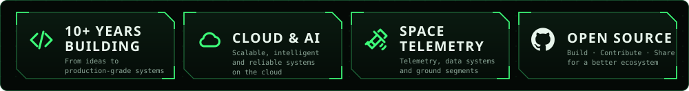
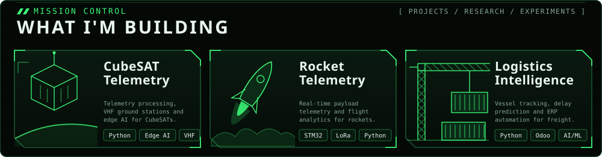
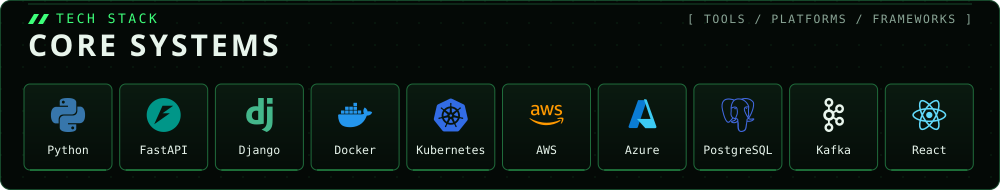
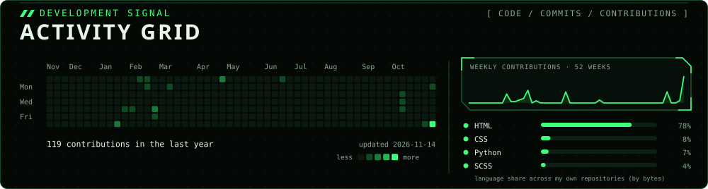
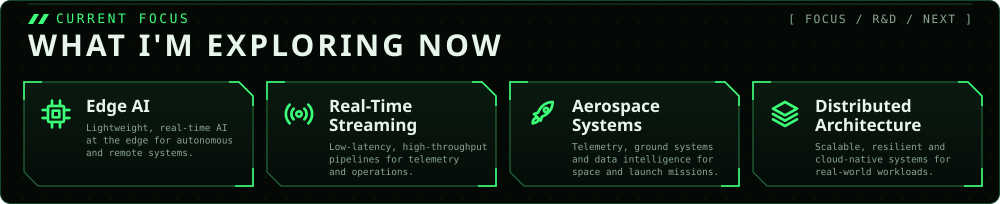

<!-- Mission-control profile. Panels are generated by scripts/build_profile.py; the activity grid refreshes daily via .github/workflows/refresh-activity.yml -->

  

  &nbsp;
  &nbsp;
  

<b>Mission log</b>: awards, education, selected systems

### Awards
- **IET Outstanding Performance Award for Innovation**, University of South Wales (2025)
- **2nd Prize**, UK National Rocketry Championship (2025)
- **3rd Prize**, Mach-25 Rocketry Competition (2025)
- **Young IT Professional Award**, Coimbatore Chapter (2017)

### Education
**BSc (Hons) Electrical & Electronic Engineering**, University of South Wales.
Capstone: IoT Industry 4.0 Smart Clinic Automation System (IET Innovation Award).

### Selected systems
- **Logistics intelligence:** vessel tracking, AI delay prediction, Odoo ERP automation. 35% fewer support queries, 40% less manual accounting, 99.95% uptime.
- **Healthcare analytics:** HIPAA-compliant, FHIR R4 pipelines, 92% accuracy on readmission-risk prediction.
- **Property intelligence:** 5B+ data points with Elasticsearch, Redis, Kafka and CQRS.

